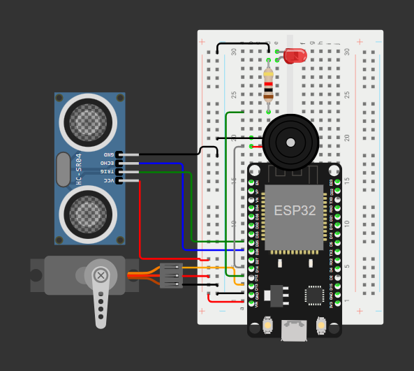

# 📡 Radar Ultrassônico com ESP32

Radar de varredura de 180° feito com **ESP32**, sensor ultrassônico **HC-SR04** e **servo motor**. O sistema detecta objetos, avisa com **buzzer** e **LEDs** e exibe um radar gráfico em tempo real no navegador, por uma rede Wi-Fi criada pela própria placa (sem precisar de roteador).



## ✨ Funcionalidades

- Varredura de 0° a 180° com passo de 3° (uma varredura completa leva cerca de 3,6 s).
- Medição de distância com o HC-SR04 e detecção de objetos a até 30 cm (configurável).
- Alarme sonoro com dois tons: agudo quando o objeto é encontrado (repetido enquanto ele estiver presente) e grave quando é perdido.
- LED vermelho (objeto encontrado) e LED verde (nenhum objeto).
- Ponto de acesso Wi-Fi próprio e servidor web com:
  - `/` – leituras de distância, ângulo do servo e status;
  - `/radar` – radar de 180° desenhado em `canvas`, com feixe de varredura e pontos que desaparecem após 4 s;
  - `/dados` – dados atuais em JSON.
- Código não bloqueante (`millis()` em vez de `delay()`), mantendo o servidor web responsivo.

## 🧰 Materiais

| Componente | Função |
|---|---|
| ESP32 (DevKit) | Microcontrolador, Wi-Fi e servidor web |
| Sensor HC-SR04 | Medição de distância |
| Servo motor SG90 | Giro do sensor |
| Buzzer passivo | Alarme sonoro |
| LED vermelho + LED verde | Indicação visual |
| 2 resistores de ~220 Ω | Limitação de corrente dos LEDs |
| Protoboard e jumpers | Montagem |

## 🔌 Ligações

| Dispositivo | Pino do ESP32 |
|---|---|
| Buzzer passivo (+) | GPIO 14 |
| LED vermelho | GPIO 12 |
| LED verde | GPIO 2 |
| HC-SR04 TRIG | GPIO 25 |
| HC-SR04 ECHO | GPIO 26 |
| Servo (sinal) | GPIO 13 |

Todos os componentes devem compartilhar o mesmo GND.

> ⚠️ **Atenção:** o HC-SR04 opera com 5 V e o ESP32 com 3,3 V nos GPIOs. Use um **divisor de tensão** no pino ECHO. Para maior estabilidade, considere alimentar o servo por uma fonte separada (com GND comum).

## 🚀 Como usar

1. Instale a [IDE Arduino](https://www.arduino.cc/en/software) e o pacote de placas **esp32** (Espressif) pelo Gerenciador de Placas.
2. Instale a biblioteca **ESP32Servo** pelo Gerenciador de Bibliotecas.
3. Mantenha `Radar_Final.ino` e `pitches.h` na mesma pasta do sketch.
4. Selecione sua placa ESP32, a porta correta e faça o upload.
5. No celular ou computador, conecte-se à rede Wi-Fi **`ESP32_Sensor`** (senha padrão `12345678`).
6. Abra `http://192.168.4.1` no navegador (o endereço também aparece no Monitor Serial, a 115200 baud) e clique em **Abrir Radar**.

> 🔒 Altere o SSID e a senha no código antes de usar em ambientes compartilhados.

## ⚙️ Parâmetros configuráveis

Ajustáveis no início de `Radar_Final.ino`:

| Constante | Valor padrão | Descrição |
|---|---|---|
| `DISTANCIA_LIMITE` | 30.0 cm | Distância abaixo da qual há objeto encontrado |
| `PASSO_GRAUS` | 3 | Avanço do servo a cada leitura |
| `INTERVALO_MS` | 60 ms | Tempo entre leituras/passos |
| `HOLD_MS` | 400 ms | Tempo que o alarme permanece ativo após a última detecção |

## 📁 Estrutura do repositório

```
.
├── Radar_Final.ino   # Código principal
├── pitches.h         # Frequências das notas musicais do buzzer
├── docs/
│   └── circuito.png       # Esquema do circuito
│   └── JSON_Circuito.txt  # JSON do esquema do circuito
└── README.md
```

## ⚠️ Problema conhecido

Durante os testes, ao impor um limite de distância na parte do código que trata dos parâmetros e da captação da distância, o sensor ficou desregulado e passou a enviar sinais falsos. **Ainda não foi possível determinar se a causa é a imposição do limite ou o próprio equipamento.**

Hipóteses em investigação:

- tensão de 5 V no ECHO sem divisor de tensão;
- quedas de tensão na alimentação causadas pelo servo;
- medições feitas durante o movimento do servo;
- intervalo curto (60 ms) entre leituras, com ecos residuais;
- qualidade do módulo HC-SR04;
- bloqueio do `pulseIn` (até 30 ms) competindo com o Wi-Fi.

Para ajudar a isolar a causa, veja os testes sugeridos nas melhorias abaixo.

## 🛣️ Melhorias futuras

- [ ] Testar a leitura bruta, sem limite, com o servo parado e depois em movimento.
- [ ] Alimentar o servo por fonte separada e incluir o divisor de tensão no ECHO.
- [ ] Filtrar as leituras pela mediana de 3 a 5 medições.
- [ ] Aumentar o intervalo entre medições.
- [ ] Testar com outro módulo HC-SR04.
- [ ] Permitir ajustar o limite de distância pela interface web.

## Autores

_Daniel Santiago Purificação_<br>
_Felipe de Lima Monteiro_<br>
_João Vitor Ludovino Leite Alves_<br>
_Nicolas Caldeira dos Santos_<br>
_Nicolas Jimenes Haase_<br>
_Pedro Dias Guedes Santos_<br>

## 📄 Licença

Defina a licença do projeto (por exemplo, MIT) e adicione o arquivo `LICENSE`.
